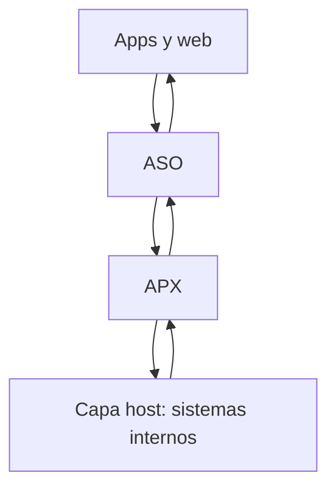

## Definición

APX es la capa de desarrollo backend de BBVA que ejecuta la lógica de negocio transaccional y se comunica con los sistemas internos. Según la descripción interna recogida, la sigla corresponde a Application Platform eXtended. Se describe como una capa intermedia entre ASO y la capa host: por encima, ASO expone servicios hacia los canales digitales; por debajo, APX trabaja contra bases de datos, mainframes y otros sistemas del banco.

La responsabilidad de APX es hacia dentro: procesar operaciones críticas, aplicar las reglas del negocio y garantizar que una transacción no se pierda ni se duplique. Habla con protocolos internos de la plataforma, RPC o mensajería, no con las APIs REST que ve el cliente.

## Por qué importa

Separa dos ritmos de cambio distintos. La capa que habla con el frontend puede mantener estable su contrato REST mientras APX evoluciona su acceso a los sistemas internos. Además, concentrar las reglas delicadas en una sola capa evita que cada canal implemente por su cuenta la misma validación transaccional.

En el día a día se trabaja en Java dentro de un entorno controlado por la arquitectura de la organización: framework propietario, plugins para Eclipse o IntelliJ, librerías internas de acceso a datos y ciclos de despliegue propios. La carga habitual son transacciones online y procesos masivos por lotes (*batch*).

## Ejemplo

Una transferencia: la app envía una petición REST a ASO; esa capa comprueba el contrato del servicio y delega la operación en APX; APX aplica las reglas de negocio, mueve el importe en el sistema interno y devuelve el resultado. La app nunca habla directamente con la base de datos ni con el mainframe.

## Se confunde con

- **ASO**: expone y orquesta servicios hacia los canales digitales. APX ejecuta la lógica transaccional hacia dentro; ambas usan Java, pero no son la misma capa ni tienen el mismo tipo de carga.
- **Capa host**: es la denominación interna de los sistemas con los que trabaja APX, en especial bases de datos y mainframes. No es el Host público de redes.
- **Data Manager**: un DM entrega datos a componentes de interfaz. APX es una capa backend de operaciones transaccionales, no una pieza de acceso a datos para la interfaz.
- **APX en complejidad computacional**: clase de problemas de optimización que admiten algoritmos de aproximación. Comparte siglas, pero no describe una plataforma bancaria.

## Fuente interna

> Esta entrada describe un sistema interno de BBVA documentado con fuente privada. No se aplica la exigencia de contraste con fuentes públicas: la expansión de la sigla, la posición de la capa y las tecnologías empleadas proceden de la descripción interna facilitada por el autor y no son verificables desde documentación pública. Quedan por documentar el framework propietario, las librerías de acceso a datos, los protocolos internos y los arquetipos de proyecto.
