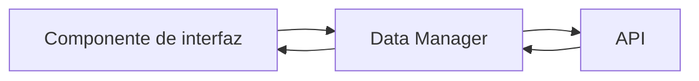

## Definición

Un Data Manager (DM) es una pieza de software orientada a obtener y gestionar datos. Normalmente se comunica con una API, procesa la respuesta y entrega el resultado a los componentes que lo necesitan. Su responsabilidad es de datos, no de presentación: no pinta interfaz.

En el ecosistema de BBVA es un tipo de dependencia compartida. El paquete `@bbva-global-apis-dm/bbva-global-api-dm-behavior` apunta a un behavior de Data Managers de Global APIs: lógica reutilizable que se incorpora a otros componentes, no un componente visual concreto. Los métodos, eventos y el formato exactos dependen de la implementación de ese paquete.

## Por qué importa

Separa quién habla con el backend de quién muestra la información. El componente visual se limita a pedir datos y pintarlos; el DM concentra la petición, el procesamiento de la respuesta y los estados comunes, como carga y error. Así, una misma forma de acceso a datos se reutiliza en varias pantallas sin repetirla en cada una.

## Ejemplo

En una pantalla de pedidos, la lista no construye la petición ni interpreta la respuesta: recibe del DM los pedidos, el estado de carga y un posible error. Si la petición falla, el componente decide cómo mostrarlo; el DM se limita a comunicar qué ocurrió.

## Se confunde con

- **Componente de interfaz**: un botón, una tarjeta o un formulario muestran datos y permiten interacción. El DM no hace ninguna de las dos cosas; por eso no se clasifica por su aspecto, sino por su responsabilidad de datos.
- **Behavior**: es lógica reutilizable que se añade a otros componentes. Un behavior puede formar parte de un DM, pero no todo behavior gestiona datos de una API, así que no son sinónimos.
- **Adapter**: en MuD los componentes y las features ya integran sus propios DMs y se evita el uso de adapters. Añadir una capa intermedia por encima del DM duplicaría esa responsabilidad.
