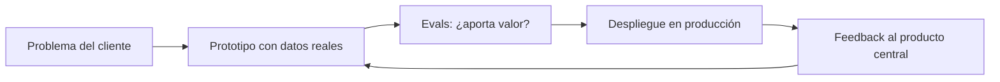

## Definición

Un Forward Deployed Engineer (FDE) es un ingeniero de software que se incorpora al equipo del cliente, trabaja con sus datos y su infraestructura y usa la plataforma de su propia empresa para resolver un problema de negocio concreto. Palantir popularizó el rol con el nombre interno «Delta» —tomado del alfabeto NATO— y lo explicó con una frase: el desarrollo de producto ofrece «una capacidad para muchos clientes»; el FDE ofrece «muchas capacidades para un cliente». El modelo se extendió después a empresas de plataformas y de IA.

Lo definitorio no es viajar ni estar presencial, sino dónde se escribe y se valida el código: en el sistema real del cliente. El encargo termina cuando la solución funciona en producción y el usuario la adopta, no cuando se entrega un informe o un prototipo.

## Por qué importa

Acorta el camino entre quien construye la plataforma y quien la usa: el FDE decide qué se resuelve a medida y qué merece entrar en el producto central, y devuelve a ese equipo lo aprendido en el campo. Cambia también qué cuenta como éxito: adopción real, impacto medible en el flujo de trabajo y evaluaciones automáticas (*evals*) que se mantienen tras el despliegue. Es una vía de entrada habitual para perfiles junior —equipos pequeños, autonomía y cliente directo—, con la responsabilidad de acotar y priorizar con incertidumbre.

## Del descubrimiento a producción

El recorrido va del proceso y los datos del cliente a un prototipo rápido, luego a una prueba de valor con *evals* y al despliegue de un caso de uso real. Es un marco didáctico divulgativo, no un estándar de la industria.

Trabajar en la infraestructura del cliente no implica aislamiento: lo que falta en el producto se lleva al núcleo con revisión del equipo correspondiente. Interpretar cada petición por separado genera lógica de «pulpo» —un núcleo sano con un tentáculo por cliente— que acaba en código espagueti.

## Ejemplo

Un equipo de soporte quiere clasificar incidencias. El FDE conecta las quejas reales, construye un clasificador, mide con *evals* si acierta y lo deja funcionando en el flujo del cliente. Solo si el patrón se repite, la capacidad pasa a la plataforma.

## Se confunde con

- **Desarrollo de producto central**: allí se construye una capacidad para muchos clientes; aquí, muchas capacidades para un cliente. No son compartimentos estancos, pero el código que vuelve al núcleo se coordina con su equipo.
- **Consultoría**: el consultor suele entregar análisis o recomendación; el FDE despliega producto existente y escribe código de producción. La frontera se ha difuminado en contrataciones recientes, así que conviene mirar el puesto concreto.
- **Solutions engineer o sales engineer**: suelen trabajar con datos anonimizados u *offline* y con un papel más consultivo; el FDE usa el entorno y las herramientas reales y no cierra el trabajo hasta verlo en producción.
- **Ingeniería de datos**: integrar modelos y *pipelines* del cliente es parte del trabajo, pero no lo define; el objetivo es un resultado de negocio que combine código, datos, despliegue y trato con el usuario.
- **Ingeniería de sistemas embebidos**: «empotrado» en el equipo del cliente describe el modo de trabajo; el *firmware* y el hardware son otra profesión.
- **AI FDE de Palantir**: en la documentación oficial es el nombre de un agente conversacional que opera Foundry, no la persona.
