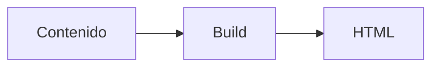

## Qué es

Mermaid convierte un texto sencillo con una sintaxis propia en diagramas: de flujo, de secuencia, de clases. Al ser texto, los diagramas viven en el repositorio y se versionan como el código.

## Para qué sirve

Permite documentar relaciones y procesos sin salir del Markdown. Aquí se prevé para diagramas en las fichas de patrones (F5), mostrados en el cliente o en el build.

## Cuándo usarlo

Cuando necesitas un diagrama que cambios con frecuencia y quieres mantenerlo junto al texto, revisable en un `git diff`.

## Cuándo no

Para ilustraciones muy elaboradas o con mucho detalle visual, una imagen vectorial hecha a mano da mejor resultado y no exige cargar JavaScript.

## Alternativas

D2 y Graphviz generan diagramas desde texto con otros enfoques; las imágenes SVG planas siguen siendo la opción simple cuando no hay que editarlas.

## Ejemplo

