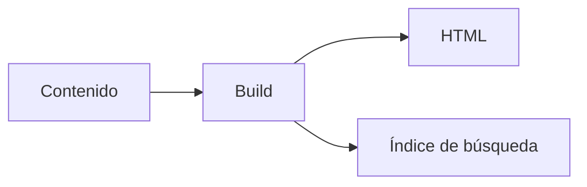

## Qué es

Mermaid genera diagramas a partir de texto con una sintaxis propia. Escribes `flowchart LR`, `sequenceDiagram` o `classDiagram` y la herramienta produce un resultado gráfico, normalmente en SVG. Al ser texto, el diagrama vive en el repositorio, se revisa en un diff y se actualiza con el código que describe. No es un editor visual: no arrastras cajas, describes relaciones.

## Para qué sirve

Documentar flujos y relaciones sin salir del Markdown ni depender de imágenes binarias. Caso concreto: explicar el recorrido de una entrada desde el contenido hasta la página publicada; el diagrama se edita en el mismo archivo que el texto y cualquiera puede corregir una flecha con un commit.

## Cuándo usarlo

- Cuando el diagrama cambia con frecuencia y quieres que su historia se vea en Git.
- Cuando el sitio ya renderiza Markdown y quieres que el diagrama se genere en el build o en el cliente sin otro paso manual.
- Cuando la estructura es sencilla: flujos, secuencias, estados o clases.

## Cuándo no

- Para ilustraciones muy elaboradas o con mucho detalle visual, una imagen vectorial hecha a mano da mejor resultado y no exige cargar JavaScript.
- Si necesitas control milimétrico de posiciones, un texto no te lo da.
- Si el diagrama es estático y nadie lo va a tocar, una imagen simple evita una dependencia más.

## Alternativas

D2 y Graphviz también generan diagramas desde texto, con sintaxis y objetivos distintos: Graphviz es muy sólido en grafos automáticos, D2 busca legibilidad. Las imágenes SVG planas siguen siendo la opción simple cuando no hay que editarlas. Para visualización de datos, en cambio, D3 es la herramienta adecuada: Mermaid describe relaciones, no escalas ni ejes.

## Matices

El texto del diagrama es código y, como tal, puede romperse: conviene revisarlo en el diff y comprobar que sigue renderizando. Según dónde se renderice, el navegador puede necesitar descargar la biblioteca; en un sitio estático interesa generar el resultado en el build cuando sea posible. Los bloques con el identificador `mermaid` dentro de Markdown se reconocen por el lenguaje declarado, igual que cualquier otro bloque de código.

## Ejemplo

Ese bloque, pegado en un archivo Markdown con soporte de Mermaid, se convierte en un diagrama sin archivos externos.
