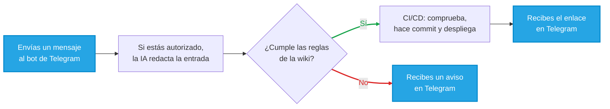

## Qué puedes pedirle

Puedes enviar el concepto que quieres incorporar y añadir detalles sobre lo que
te gustaría ver en la explicación. Por ejemplo, puedes pedir una definición de
_closure_ con ejemplos en JavaScript y Python.

El bot se ocupa de preparar una propuesta con la estructura de la wiki. No es un
asistente de preguntas y respuestas: su función actual es ayudar a crear entradas
nuevas.

## Cómo iniciar una solicitud

1. Envía `/start` al bot para recibir las instrucciones.
2. Escribe `/add` seguido del concepto y, si quieres, de los detalles que debe
   incluir.

```text
/add closure con ejemplos en JavaScript y Python
```

También puedes enviar el concepto sin `/add`. No hace falta que indiques la
colección o la categoría: se proponen automáticamente según el contenido.

## El recorrido de una solicitud



El bot no escribe la entrada directamente: se apoya en un modelo de lenguaje
para redactarla y en el sistema de integración y despliegue (CI/CD) del
repositorio para comprobarla y publicarla.

## Qué ocurre después

1. El bot confirma que ha recibido la solicitud y que ha podido iniciar el
   proceso.
2. El sistema redacta la entrada y la revisa contra las reglas de la wiki. Si
   algo no encaja, lo intenta de nuevo; el proceso suele tardar unos minutos.
3. Si se completa correctamente, recibirás un mensaje con el enlace a la entrada
   y el aviso de que la publicación se completa en breve. El sitio se despliega
   poco después del commit, así que el enlace puede tardar un momento en
   responder.
4. Si falla la generación, la validación o el envío del cambio al repositorio,
   recibirás un aviso en el chat. Cuando el fallo ocurre en GitHub Actions, el
   aviso incluye el enlace a la ejecución, indica si se llegó a publicar algo y
   te pide resolver el error e intentarlo de nuevo.

## Quién puede usarlo

Por seguridad, el bot solo procesa mensajes de la cuenta autorizada para este
proyecto. Los mensajes de otras cuentas se ignoran.
