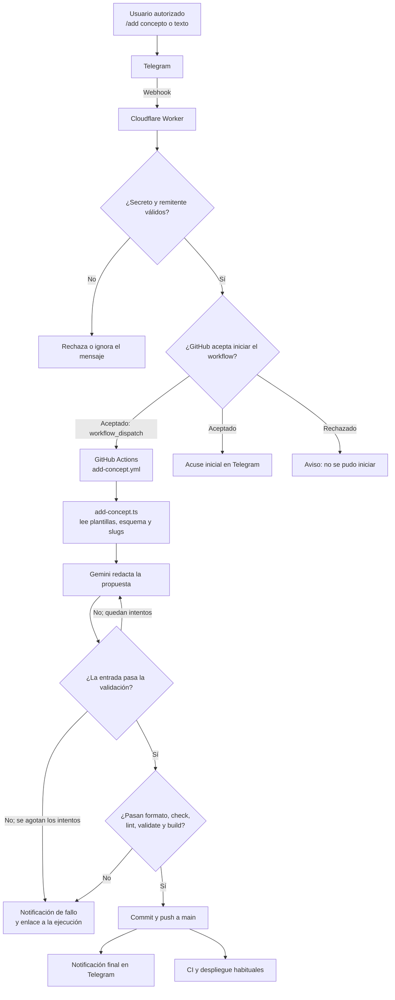

## Componentes

- **Telegram** entrega cada mensaje al webhook del proyecto.
- **Cloudflare Worker** comprueba el secreto del webhook y que el remitente esté
  autorizado. Después inicia el workflow de alta en GitHub Actions y pasa el
  texto y el chat al que se enviará el resultado.
- **GitHub Actions** ejecuta `add-concept.yml`. El script
  `scripts/add-concept.ts` prepara el contexto y solicita a Gemini una entrada
  en Markdown.
- **El repositorio** recibe un commit en `main` solo después de superar las
  comprobaciones. El push inicia los flujos habituales de CI y publicación.

## Flujo de una solicitud

El Worker devuelve un acuse inicial cuando GitHub acepta el inicio del workflow.
La confirmación final llega desde el propio workflow, una vez terminada la
generación y el push.

## Generación y validación

El script lee las plantillas, los esquemas y los slugs existentes del checkout.
Así, la entrada se redacta con las reglas vigentes y no sobrescribe otra que ya
exista. Gemini propone la colección, categoría y etiquetas a partir del texto
recibido; el usuario no tiene que escogerlas.

Cada propuesta se valida antes de continuar. Si la respuesta de Gemini o la
entrada no es válida, el script puede realizar hasta cuatro intentos, alternando
los modelos configurados y esperando entre ellos. Si no logra una entrada
válida, el workflow se detiene sin hacer commit.

## Comprobaciones y publicación

Cuando la entrada pasa la validación inicial, el workflow aplica Prettier y
ejecuta `check`, `lint`, `format:check`, `validate` y `build`. Si todo termina
correctamente, hace commit y push a `main`. Ese push activa por separado los
workflows habituales del repositorio; el alta no espera a que termine el
despliegue para enviar su notificación.

## Autorización y credenciales

El Worker solo acepta peticiones con el encabezado secreto que Telegram asigna
al webhook y procesa mensajes del remitente autorizado. Los tokens y claves se
guardan en Cloudflare o en GitHub Actions, según el servicio que los usa; no se
incluyen en el código ni en el contenido del repositorio.

- `TELEGRAM_BOT_TOKEN`: envío de mensajes desde el Worker y GitHub Actions.
  `TELEGRAM_SECRET`: validación del webhook en Cloudflare.
- `GITHUB_TOKEN`: el Worker lo usa para iniciar el workflow.
- `ADD_CONCEPT_TOKEN` y `LLM_API_KEY`: GitHub Actions los usa para acceder al
  repositorio y llamar a Gemini.
