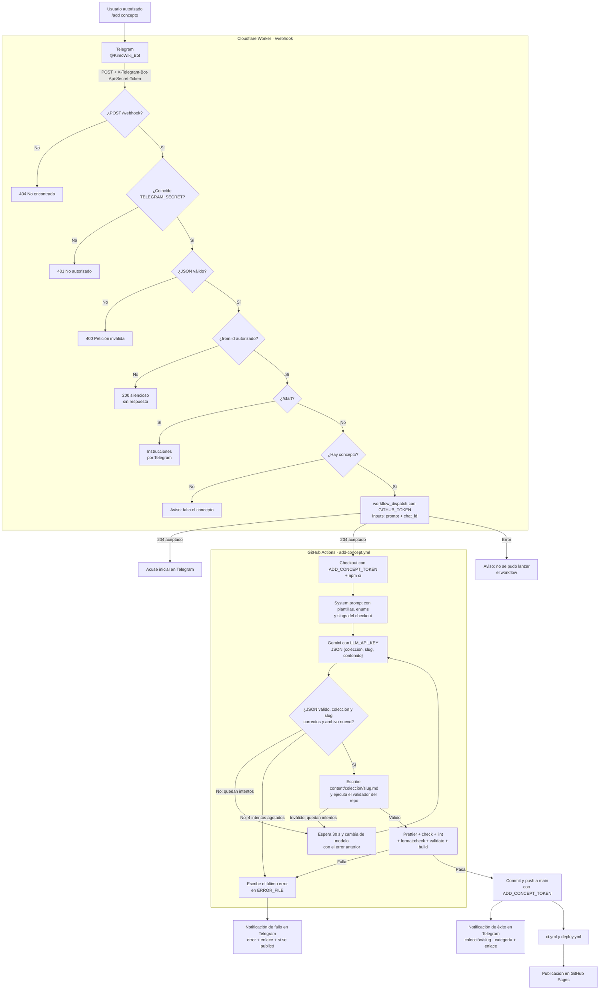

## Componentes

- **Telegram** entrega cada mensaje del bot `@KimoWiki_Bot` al webhook del
  proyecto.
- **Cloudflare Worker** atiende solo `POST /webhook`. Comprueba el secreto que
  Telegram añade a la petición, descarta los mensajes de otras cuentas, resuelve
  `/start` y lanza el workflow con el concepto y el chat de notificación. No
  llama al modelo: solo despacha el trabajo.
- **GitHub Actions** ejecuta `add-concept.yml`. Hace el checkout con el PAT,
  instala las dependencias y ejecuta `scripts/add-concept.ts`.
- **El script** construye el contexto con las plantillas, los enums y los slugs
  que ya existen en el repositorio, pide la entrada a Gemini, la escribe y la
  valida antes de darla por buena. Si algo falla, reintenta con el modelo
  alterno.
- **El workflow** aplica Prettier y ejecuta las comprobaciones del proyecto. Solo
  si todas pasan hace commit y push.
- **El repositorio** recibe un único archivo nuevo en `content/`. El push activa
  por separado `ci.yml` y `deploy.yml`, que publican el sitio en GitHub Pages.

## Flujo completo

El Worker responde a Telegram en cuanto GitHub acepta el inicio del workflow; la
confirmación final la envía el propio workflow cuando termina. El diagrama separa
las tres fases y muestra qué credencial interviene en cada salto.

La notificación de éxito sale al hacer el push, no cuando termina el despliegue;
por eso el enlace puede tardar un momento en abrir la entrada publicada.

## Qué responde el webhook

| Situación | Respuesta del Worker |
| --- | --- |
| Petición que no es `POST /webhook` | `404 No encontrado` |
| Falta el encabezado secreto o no coincide | `401 No autorizado` |
| El cuerpo no es JSON | `400 Petición inválida` |
| Mensaje sin texto o de otra cuenta | `200` sin respuesta: se ignora |
| `/start` | Instrucciones de uso |
| `/add` sin concepto, o texto vacío | Aviso de que falta el concepto |
| GitHub rechaza el `workflow_dispatch` | Aviso para revisar los logs de Actions |
| GitHub acepta el workflow | Acuse inicial; el workflow sigue por su cuenta |

El prefijo `/add` es opcional y también se acepta como `/add@nombre_del_bot`.
Todo lo demás se toma como el concepto solicitado. A los mensajes de cuentas no
autorizadas se les contesta `200` sin enviar nada, para no revelar que el bot
existe.

## Generación y validación

El script construye un *system prompt* con las plantillas de
`specs/plantillas`, los enums de `src/lib/content/esquemas.ts` (colecciones,
categorías, etiquetas y secciones obligatorias) y los slugs que ya existen en
`content/`. El esquema no va escrito a mano en el prompt: se lee del checkout
para que no se desincronice.

Después pide a Gemini una respuesta JSON con `{ coleccion, slug, contenido }`.
El modelo decide la colección, la categoría y las etiquetas; el usuario solo
describe el concepto. La llamada usa `GEMINI_API_KEY` (el secreto `LLM_API_KEY`
se expone con ese nombre en el paso) y fuerza una respuesta JSON.

Antes de aceptar la propuesta, el script comprueba que la colección exista, que
el slug sea kebab-case de hasta 64 caracteres y que el archivo no exista; luego
escribe el `.md` y ejecuta el validador de contenido del repositorio. Si la
propuesta no pasa estos controles, descarta el archivo cuando llegó a
escribirlo, espera 30 segundos y reintenta con el otro modelo
(`gemini-3.8-flash` y `gemini-3.6-flash` alternados), pasando el error anterior
como contexto. Hay cuatro intentos como máximo. Si se agotan, deja el último
error en `ERROR_FILE`, el job termina con error y no hay commit.

## Comprobaciones y publicación

Cuando el script termina, el workflow pasa Prettier al archivo generado y
ejecuta `check`, `lint`, `format:check`, `validate` y `build`. Un fallo en
cualquiera de estos pasos detiene el job sin hacer push.

Si todo pasa, el workflow hace commit con el autor `wiki-dev-kimo-ia-bot` y sube
el cambio a `main` con el PAT. Ese push activa por separado `ci.yml` y
`deploy.yml`; el alta no espera a que termine el despliegue para notificar.

La notificación de éxito incluye `coleccion/slug`, la categoría, el enlace a la
entrada y el aviso de que la publicación se completa en breve. La de fallo
incluye el último error disponible (si `add-concept.ts`
llegó a escribir `ERROR_FILE`), el enlace a la ejecución y si el cambio llegó a
subirse a `main`. Si no se subió, recuerda que no se ha publicado ningún cambio
y pide resolver el error e intentarlo de nuevo. Ambas se omiten si no hay
`chat_id` o `TELEGRAM_BOT_TOKEN`.

## Autorización y credenciales

La autorización tiene tres capas: el Worker solo atiende `POST /webhook`, exige
el encabezado `X-Telegram-Bot-Api-Secret-Token` con el valor de
`TELEGRAM_SECRET` (comparado en tiempo constante) y procesa únicamente los
mensajes cuyo `from.id` coincide con `TELEGRAM_ALLOWED_USER_ID`.

| Secreto o configuración | Dónde vive | Uso |
| --- | --- | --- |
| `TELEGRAM_BOT_TOKEN` | Worker y GitHub Secrets | Enviar mensajes con la Bot API (`sendMessage`), desde el Worker y desde las notificaciones del workflow |
| `TELEGRAM_SECRET` | Worker | Validar el encabezado secreto que Telegram añade al webhook |
| `TELEGRAM_ALLOWED_USER_ID` | Config del Worker (no secreta) | Único `from.id` autorizado |
| `GITHUB_REPO` | Config del Worker (no secreta) | Repositorio `owner/repo` al que se lanza el workflow |
| `GITHUB_TOKEN` | Worker | Autenticar el `workflow_dispatch` en la API de GitHub; es el mismo PAT que `ADD_CONCEPT_TOKEN` |
| `ADD_CONCEPT_TOKEN` | GitHub Secrets | Hacer el checkout y el push a `main` |
| `LLM_API_KEY` | GitHub Secrets | Llamar a Gemini; el paso lo expone como `GEMINI_API_KEY` |

El PAT se guarda con dos nombres porque lo usan dos sistemas distintos:
`ADD_CONCEPT_TOKEN` en GitHub Actions y `GITHUB_TOKEN` en el Worker. Ese
`GITHUB_TOKEN` del Worker no es el token automático de Actions: los push hechos
con el token automático no disparan otros workflows, así que `ci.yml` y
`deploy.yml` no se ejecutarían. La clave de Gemini nunca llega al Worker ni al
repositorio: solo existe en GitHub Secrets y se usa durante el paso de
generación.
