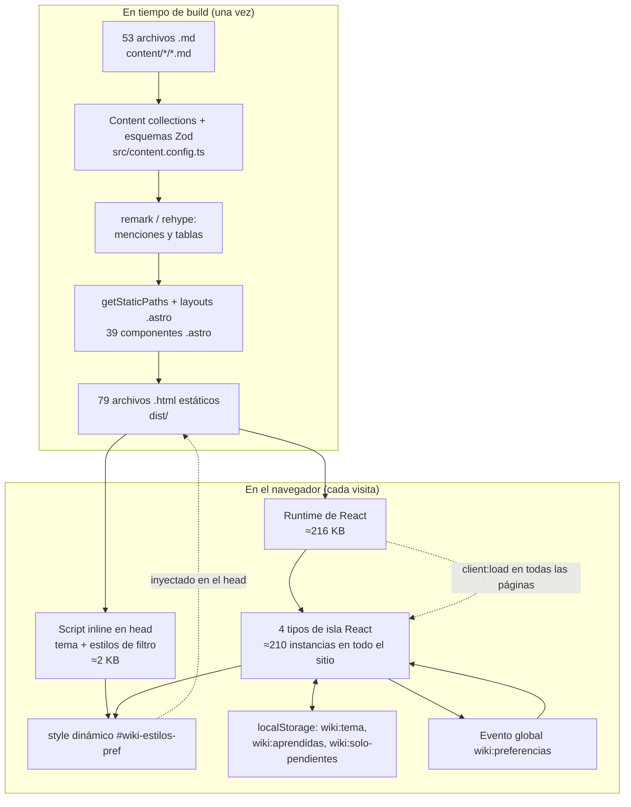
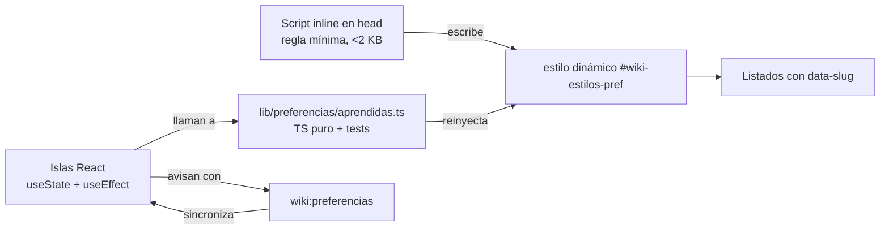
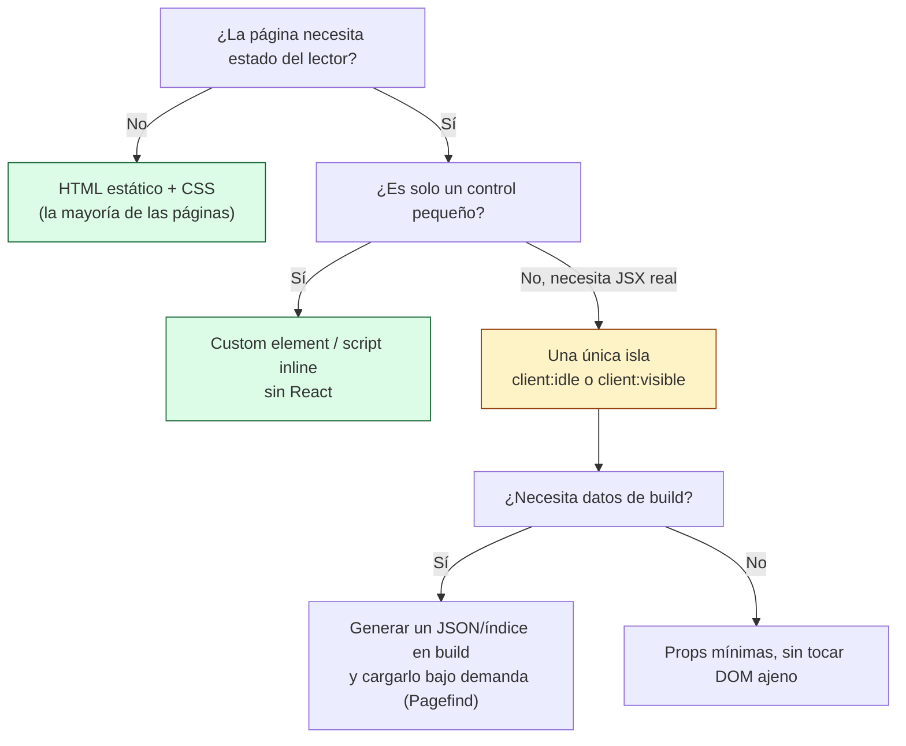

# ¿Astro o React para wiki-dev?

**Fecha:** 2026-11-25
**Alcance:** análisis del código actual (`src/`, `content/`, `scripts/`, `worker/`) y de un build de producción real generado con `npm run build`.
**Autoría:** informe de análisis. No he cambiado código; `dist/` se ha regenerado y está ignorado por git.

> **Actualización (misma fecha):** tras la aprobación del autor se ha ejecutado el
> paso 1 y la vía minimalista del paso 2: React ya no está en el proyecto, las
> cuatro islas son custom elements y el buscador lee un `buscador.json`
> generado en build. Pagefind no se implantó: era la otra vía del paso 2 y queda
> en espera de decisión futura, ni descartada ni como tarea pendiente o trabajo
> sin terminar (ver `specs/PAGEFIND-EN-ESPERA.md`). Este documento conserva el
> estado y las mediciones anteriores a ese cambio.

## Resumen ejecutivo

**Mantén Astro.** No migrar a React + Vite ni a Next.js. El proyecto sigue siendo, por naturaleza, un sitio de contenido: 53 archivos Markdown que se convierten en 79 páginas HTML estáticas. La lógica que se ha añadido (tema, aprendidas, filtro y buscador) es interactividad de lector, no una aplicación con datos por petición, sesión ni backend propio.

Dicho esto, **la frontera entre información y código se ha desdibujado en tres puntos concretos**, y React se está pagando en sitios donde no aporta nada:

1. React se descarga en **las 79 páginas** por dos botones de 2–3 KB que hay en la cabecera.
2. El buscador de la portada hidrata **las 53 entradas completas** (≈16 KB en el HTML) para hacer un `filter()` de cuatro campos y, además, modifica un `<div>` que no es su isla.
3. La misma regla de preferencias está implementada **tres veces**: script inline en `<head>`, módulos `lib/preferencias/*.ts` y estados de React, coordinados por un evento global.

Mi recomendación no es cambiar de framework, sino **reducir React a cero o a una sola isla**, y escribir la regla que ya casi seguimos: _el contenido nunca se hidrata; solo se hidrata el estado del lector_.

> Veredicto corto: **Astro sí, React como framework no; React como renderer de islas, solo mientras compensa.**

---

## 1. Mapa real: qué es información y qué es código



### Lo que es información (y debe seguir estático)

| Responsabilidad                  | Dónde vive                                        | Se hidrata?  |
| -------------------------------- | ------------------------------------------------- | ------------ |
| Texto de las entradas            | `content/<coleccion>/*.md`                        | No           |
| Esquemas, categorías y etiquetas | `src/lib/content/esquemas.ts`                     | No           |
| Acceso a contenido (fachada)     | `src/lib/content/entradas.ts`                     | No           |
| Menciones automáticas y tablas   | `src/lib/markdown/` (remark/rehype)               | No           |
| Rutas, índices, migas, backlinks | `src/pages/`, `src/features/*/*.astro`            | No           |
| Diagramas Mermaid                | `astro-mermaid`, solo 3 páginas con `pre.mermaid` | Bajo demanda |

### Lo que es código (estado del lector)

| Isla                        | Directiva     | Dónde             | Tamaño del chunk |
| --------------------------- | ------------- | ----------------- | ---------------- |
| `InterruptorTema`           | `client:load` | Todas las páginas | 2,2 KB           |
| `InterruptorSoloPendientes` | `client:load` | Todas las páginas | 2,7 KB           |
| `BotonAprendida`            | `client:load` | Las 51 fichas     | 2,8 KB           |
| `BuscadorRapido`            | `client:idle` | Solo la portada   | 7,1 KB           |

Las islas se renderizan también en servidor (`ssr` en el HTML generado), así que el botón ya existe antes de hidratar: no hay salto de layout. Eso está bien hecho.

Toda la lógica de preferencias es TypeScript puro y está testeada (`src/lib/preferencias/`, 13 archivos de test en el repositorio). `catalogo.ts` importa solo el _tipo_ de `esquemas.ts` para no arrastrar Zod al cliente. También está bien hecho.

---

## 2. Datos medidos del build

| Métrica                                  | Valor                               |
| ---------------------------------------- | ----------------------------------- |
| Páginas generadas                        | 79                                  |
| Entradas Markdown                        | 53 (51 fichas + 2 páginas del bot)  |
| HTML de la portada                       | 213 KB                              |
| Props serializadas en la portada         | ≈16 KB (las 53 entradas)            |
| Runtime React (`client.js` + `react.js`) | ≈216 KB por página, sin comprimir   |
| `page.js` (Astro)                        | ≈7 KB por página                    |
| Tamaño total de JS generado              | 3,7 MB en disco, sobre todo Mermaid |
| Páginas que cargan diagramas Mermaid     | 3 de 79                             |

Comandos para reproducirlo:

```bash
npm run build
grep -oE 'src="[^"]+\.js"' dist/index.html
ls -lhS dist/_astro/*.js | head
```

Matiz importante: 216 KB es el **peso sin comprimir en la primera visita**; el navegador lo cachea entre páginas y con Brotli basta bastante. Mermaid, en cambio, **no** se carga en las 76 páginas sin diagramas: Astro hace ahí exactamente lo que debe.

---

## 3. El problema no es Astro, es dónde está la frontera

### 3.1. React se paga donde no se usa

`BaseLayout.astro` incluye los dos interruptores con `client:load`, y **todas** las páginas usan `BaseLayout`. Resultado: una página de contenido que solo tiene texto y un botón de tema descarga el runtime completo de React para hidratar dos `<button>`.

Si esos dos botones fueran un _custom element_ nativo (o un par de scripts inline con `addEventListener`), React podría desaparecer de las 79 páginas y quedar solo en la portada, o en ninguna. El ahorro potencial es de ≈216 KB por página en la primera carga.

### 3.2. El buscador hidrata contenido, no estado

`src/pages/index.astro` convierte las 53 entradas en props y se las pasa a `BuscadorRapido.tsx`:

```astro
<BuscadorRapido client:idle entradas={entradasParaBusqueda} />
```

Dentro, `useMemo` filtra por `titulo`, `resumen`, `categoria` y `tags`. Es una operación que podría hacer un script de 30 líneas sobre un JSON generado en build. Además, el componente hace dos cosas que rompen el aislamiento de la isla:

- `document.getElementById("secciones-portada").style.display = "none"` (modifica DOM de fuera de su isla).
- Escucha clics en todo el `document` para implementar «Mostrar todo» (`InterruptorSoloPendientes.tsx`).

Es código perfectamente válido, pero ya no es una isla autocontenida: **es una isla que gobierna otras zonas de la página**.

### 3.3. Una regla, tres implementaciones



Está documentado y hay un test de coherencia entre el script inline y el módulo TS. Aun así, es frágil: cualquier cambio en el filtro exige tocar tres sitios. Es el síntoma más claro de que la lógica ha crecido más de lo que el modelo de «islas mínimas» preveía (RF-14 de `specs/spec.md` dice explícitamente _«las islas mínimas»_).

### 3.4. Pagefind está en la spec y en `package.json`, pero no en el código

`specs/spec.md` (RF-08 y §10) define búsqueda de texto completo con Pagefind, alias, cuerpo y tolerancia a erratas; el workflow de deploy lo tiene comentado. La implementación actual es un filtro en cliente sobre título/resumen/categoría/etiquetas: no busca en alias ni en el cuerpo, y «zustnad» no devuelve Zustand.

Esto **no es un problema de Astro**: es una diferencia entre spec e implementación. Pero conviene resolverlo antes de decidir nada sobre frameworks, porque cambia el tamaño del buscador por completo: con Pagefind no haría falta enviar 53 entradas al cliente.

---

## 4. Comparativa de opciones

| Opción                                  | JS en páginas de contenido                                    | Encaje con Markdown/esquemas                                             | Coste de migración                              | Veredicto                                           |
| --------------------------------------- | ------------------------------------------------------------- | ------------------------------------------------------------------------ | ----------------------------------------------- | --------------------------------------------------- |
| **Astro + React islands (actual)**      | ≈223 KB por página + 2–7 KB de islas                          | Excelente: collections, remark y SSG ya funcionan                        | Ninguno                                         | Correcto, pero caro para tres botones               |
| **Astro + islas nativas (recomendado)** | ≈2 KB del script inline                                       | El mismo                                                                 | Bajo: reescribir 4 componentes pequeños         | **Mejor encaje con RNF-02**                         |
| **Astro + Preact islands**              | ≈10–15 KB                                                     | El mismo                                                                 | Medio: cambiar renderer, revisar stories `.tsx` | Buena alternativa si quieres seguir escribiendo JSX |
| **React + Vite (SSG)**                  | Runtime React en todas partes                                 | Hay que reimplementar collections, remark y rutas con `import.meta.glob` | Alto                                            | No aporta nada aquí                                 |
| **Next.js**                             | Depende de RSC, pero build y despliegue orientados a servidor | Hay que portar pipeline y adaptar salida estática a GitHub Pages         | Muy alto                                        | Solo si aparece backend/API/sesión                  |

Hoy el «backend» del proyecto ya está donde debe estar: un Worker de Cloudflare en `worker/src/index.ts` que recibe el webhook de Telegram y lanza el workflow de GitHub. Next.js no sustituye eso; solo añadiría otra capa.

---

## 5. Recomendación concreta, sin migrar



### Paso 1 — quitar React de la cabecera (mayor retorno, menor riesgo)

Los tres controles de preferencias (`InterruptorTema`, `InterruptorSoloPendientes`, `BotonAprendida`) son botones de 2–3 KB. Conserva `src/lib/preferencias/*.ts` tal cual y sustituye los `.tsx` por un único custom element (por ejemplo `<wiki-preferencias>`) registrado desde un script de Astro, o por un par de listeners inline.

- Se mantiene `localStorage`, `aria-pressed`, el evento y el test de coherencia.
- Desaparecen `@astrojs/react`, `react` y `react-dom` de las fichas.
- Si decides conservar Astrobook, sus stories `.tsx` habría que pasarlas a `.astro` o mantener el renderer solo en desarrollo.

### Paso 2 — arreglar el buscador

Elige una de estas dos vías:

- **Alineada con la spec:** ejecutar Pagefind tras el build y que la isla consulte su índice. Elimina las props de 16 KB y permite buscar en cuerpo y alias.
- **Minimalista:** generar `buscador.json` en build y cargarlo con `fetch` cuando el usuario escriba. Sigue siendo un filtro, pero sin enviar los datos en el HTML de todas las formas.

En ambos casos, quita la mutación de `#secciones-portada`: que la isla emita un evento y sea una pieza Astro la que oculte/muestre esa sección.

### Paso 3 — escribir la regla y protegerla

Añadir una entrada corta en `specs/spec.md` o un ADR:

> El contenido se genera en build y nunca se hidrata. Solo se hidrata el estado del lector, en componentes que no modifican DOM fuera de su propio subtree.

Y revisar a mano el presupuesto de JS con Lighthouse en Chrome DevTools (RNF-01), para que RNF-02 deje de ser solo una intención.

### ¿Y si echas de menos JSX?

`@astrojs/preact` con `preact/compat` es el punto medio: el mismo código de hooks con un runtime mucho menor. Es una opción razonable si los componentes van a crecer, pero para tres botones hoy sería cambiar una dependencia por otra sin ganar claridad.

### Cuándo sí cambiaría de opinión

Migrar a React/Next.js tendría sentido si apareciera alguna de estas necesidades: cuentas o sesiones, datos en tiempo real, editor de contenido desde la web, rutas API propias o render por petición. Nada de eso está en la spec actual, y el Worker ya cubre la única integración externa.

---

## 6. Conclusión

Astro fue la decisión correcta al principio **y sigue siéndolo**. El proyecto no se ha convertido en una aplicación: se ha convertido en un sitio de contenido con **tres controles de preferencia y un buscador**. La lógica añadida no justifica un framework de aplicación; justifica ordenar la que ya tenemos.

Lo que sí conviene corregir no es el framework, sino la disciplina de islas: **menos React, más HTML, una sola fuente de verdad para las preferencias y un buscador que no arrastre el contenido**. Con esos tres cambios el proyecto queda más cerca de su propia spec (RNF-02, RF-08 y RF-14) sin renunciar a nada de lo que ya funciona.

### Limitaciones del análisis

- Los tamaños son de archivos sin comprimir; en red con Brotli el coste real es menor.
- No he ejecutado Lighthouse: requiere Chrome/Chromium y el resultado depende del entorno.
- No he modificado código: este documento es solo la valoración solicitada.
