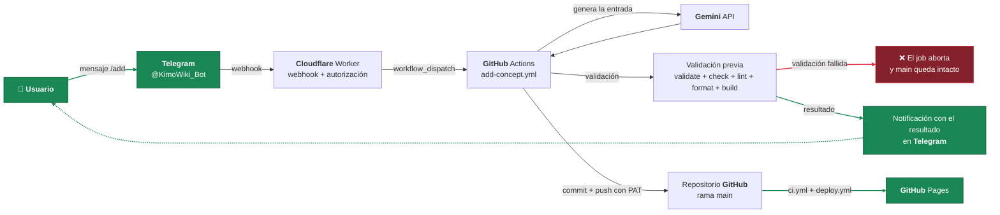
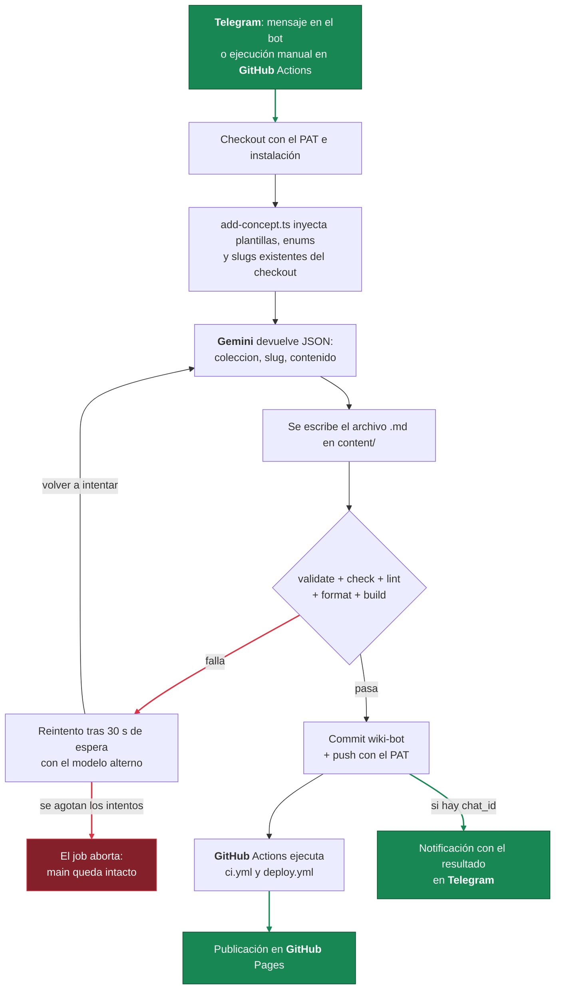

# Alta de conceptos vía Telegram

Documentación del flujo ChatOps que permite dar de alta conceptos en la wiki
desde Telegram, sin abrir el ordenador, manteniendo `main` siempre verde y el
sitio siempre desplegado.

## Descripción general

La wiki es un sitio estático (Astro + GitHub Pages) sin backend propio. El
flujo añade un eslabón intermedio —un bot de Telegram y un webhook— para que
una petición en el chat se traduzca en un *commit* validado en el repositorio:

En verde, la entrada manual y lo que el usuario ve (mensaje, publicación,
notificación); en rojo, el camino de error. En resumen: **Telegram →
Cloudflare Worker → GitHub Actions → commit en `main` → CI y deploy
automáticos**.

## Componentes

| Componente | Papel |
|---|---|
| Bot `@KimoWiki_Bot` | Recepción de las peticiones del usuario en Telegram |
| Cloudflare Worker (`worker/`) | Webhook: valida el mensaje y lanza el workflow |
| Workflow `add-concept.yml` | Genera, valida y publica la entrada |
| Script `scripts/add-concept.ts` | Orquesta la generación con Gemini (elegir colección, categoría y tags) y la validación |
| `ci.yml` / `deploy.yml` | Validación y publicación del repositorio, sin cambios |

## Credenciales y configuración

Todo el flujo se sostiene sobre cuatro credenciales. Ninguna vive en el
código: siempre en secrets.

| Credencial | Dónde vive | Para qué | Obtención |
|---|---|---|---|
| `TELEGRAM_BOT_TOKEN` | GitHub Secrets + Worker | Firmar las respuestas del bot a Telegram | @BotFather → `/newbot` |
| `TELEGRAM_USER_ID` | Worker | Autorizar solo al usuario propietario (`from.id`) | `getUpdates` tras enviar `/start` al bot |
| `ADD_CONCEPT_TOKEN` | GitHub Secrets | PAT que permite el push a `main` **y** lanzar el workflow desde el Worker | GitHub → Fine-grained PAT |
| `LLM_API_KEY` | GitHub Secrets | Llamar a la API de Gemini desde el workflow | Google AI Studio → Create API key |

El Worker se autentica además con un quinto secreto, `TELEGRAM_SECRET`, una
cadena aleatoria generada en su despliegue que se registra como
`secret_token` en el webhook de Telegram; Telegram la devuelve en la cabecera
`X-Telegram-Bot-Api-Secret-Token` de cada notificación para demostrar que
llega realmente de él. El registro se hace con `setWebhook` apuntando a la
ruta `/webhook` del Worker.

### Por qué un PAT y no el token por defecto

GitHub entrega un `GITHUB_TOKEN` automático a cada workflow, pero los *push*
hechos con ese token **no disparan otros workflows**. Sin PAT, el commit del
concepto subiría a `main` pero `ci.yml` y `deploy.yml` no se ejecutarían: la
wiki no se validaría ni se publicaría. El PAT (permisos `Contents: read
and write` y `Actions: read and write`, limitado al repositorio) evita eso y
a la vez sirve al Worker para lanzar el `workflow_dispatch`.

### Por qué Gemini

API con tier gratuito suficiente para uso ocasional. La key se asocia a un
proyecto de Google Cloud (obligatorio, pero gratuito y sin tarjeta) y se usa
únicamente desde GitHub Secrets: nunca llega al Worker ni al repositorio.

## Decisiones de configuración

Configuración adoptada; se documenta tal y como queda establecida:

- **Identidad del bot** — `kimo_wiki_add` (`@KimoWiki_Bot`), creado con
  @BotFather, con descripción propia y comandos `/add` y `/start`. El
  `TELEGRAM_BOT_TOKEN` obtenido ahí es el valor integrado en GitHub Secrets
  y el que usa el Worker.
- **Modelo de autorización** — un único usuario autorizado:
  `TELEGRAM_USER_ID = 123347601`, el `from.id` del chat privado tras enviar
  `/start`. (Atajo fácil de dar: la primera parte del token del bot,
  `9250531026`, es el ID del propio bot, no el del usuario.)
- **Acceso a GitHub** — PAT *fine-grained* con alcance exclusivo a
  `kimografico/wiki-dev`, permisos `Contents` y `Actions` en lectura y
  escritura, caducidad de 90 días. Un único token cumple las dos funciones
  del flujo: el push del workflow y el `workflow_dispatch` del Worker.
- **Proveedor de LLM** — Google Gemini (`gemini-3.8-flash`) por su tier
  gratuito; la key pertenece a un proyecto de Google Cloud gratuito y vive
  solo en GitHub Secrets.
- **Reintentos** — hasta cuatro intentos alternando `gemini-3.8-flash` y
  `gemini-3.6-flash`, con 30 segundos de espera entre ellos para absorber los
  errores 503 de alta demanda; cada intento se alimenta del error anterior.
  Si se agotan, el job aborta sin tocar `main` y la frase del último error
  (código, mensaje y estado) se incluye en la notificación de fallo.
- **Secrets integrados** — `ADD_CONCEPT_TOKEN`, `LLM_API_KEY` y
  `TELEGRAM_BOT_TOKEN` dados de alta en *Settings → Secrets and variables →
  Actions*. Los secretos del Worker se cargan con
  `cf deploy --secrets-file`, apuntando a un archivo temporal fuera del
  repositorio.
- **Modo de pruebas** — el workflow puede lanzarse a mano desde la pestaña
  Actions con los inputs `prompt` y `chat_id`; sin `chat_id` la notificación
  a Telegram se omite.
- **Estrategia de publicación** — commits directos a `main` con validación
  previa obligatoria (el job no hace push si algo falla), en lugar de rama
  y PR: con un solo mantenedor el coste del PR no compensa.

## Flujo de ejecución

Reglas que sostiene el flujo: el schema y las plantillas se leen del
checkout (nunca van hardcodeados en el prompt), una entrada existente jamás
se sobrescribe y sin `chat_id` la notificación se omite. La colección
(`glosario`, `tecnologias`, `paquetes`, `comparativas`, `patrones`, `ia` o
`testing`), la `categoria` y
los `tags` no los elige el usuario: los decide el modelo entre los valores
de los enums de `src/lib/content/esquemas.ts`, con criterios en el prompt
(qué es concepto, qué es tecnología, qué es paquete, qué es comparativa,
qué es patrón, qué es IA, qué es testing) y
validados después por el validador; la notificación de éxito los muestra
junto al enlace directo a la entrada publicada.

## Notas operativas

- **Caducidades**: el PAT caduca a los 90 días (renovarlo y sobrescribir
  `ADD_CONCEPT_TOKEN`); el token OAuth de la CLI de Cloudflare caducó el
  16/11/2026 y se renueva con `cf auth login`.
- **Rotación**: si un secreto se filtra, se regenera el valor y se
  sobrescribe el secret en GitHub o en el Worker; los secrets no se pueden
  leer desde la UI, solo ver si existen.
- **Cuota**: el tier gratuito de Gemini y el uso puntual del bot no
  representan coste; el workflow solo se lanza por petición.
